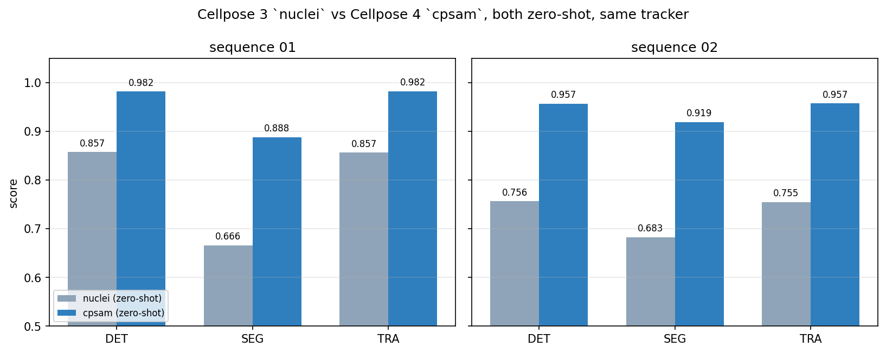
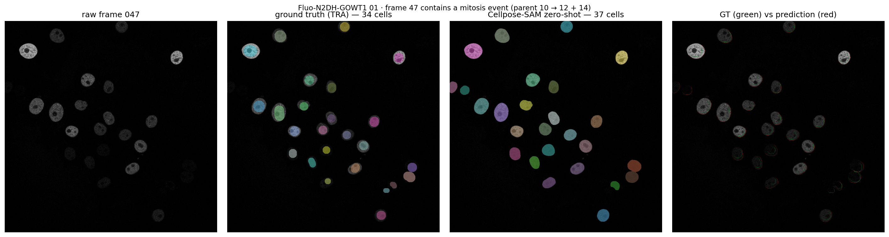

# 细胞追踪项目 · 阶段结果与下一步

> 给组员看的版本。所有数字都是在这台机器上真跑出来的（RTX 3060 Laptop，torch 2.14.1+cu126），
> 不是文献引的。跑法见第 7 节，你可以自己复现。

---

## 0. 一句话

把 Cellpose 4 的通用模型 **`cpsam`**（1.15 GB，**零样本**，没在这个数据集上训练过）接上我们自己的追踪器，
TRA 从 `0.857 / 0.755` 直接提到 **`0.982 / 0.957`**。

剩下的误差已经不是"分割不行"了，而是三件很具体的事：
**① 漏掉小而暗的细胞、② 把贴着图像边缘的细胞也算进来、③ 分裂一次都没检对。**

---

## 1. 主结果

同一条链路（分割 → 追踪 → 官方指标），唯一的变量是分割模型：

| | 01 `nuclei` | **01 `cpsam`** | 02 `nuclei` | **02 `cpsam`** |
|---|---|---|---|---|
| **DET** | 0.8573 | **0.9818** | 0.7563 | **0.9570** |
| **SEG** | 0.6662 | **0.8878** | 0.6827 | **0.9192** |
| **TRA** | 0.8565 | **0.9821** | 0.7550 | **0.9574** |
| OP_CTB (SEG 与 TRA 均值) | 0.7613 | **0.9349** | 0.7188 | **0.9383** |
| 输出轨迹数（真值 28 / 58） | 47 | **41** | 118 | **76** |



速度：**2.18 s/帧**，峰值显存 **1.84 GB**，一个序列 92 帧约 **3.5 分钟**。
（不是"跑不动"，我们之前判断错了——主环境的 torch 是 CPU 版，venv 里装了 CUDA 版就好了。）

---

## 2. 关键发现：错误结构整个换了

总分只是一行数字，下面这张表才是重点。官方 AOGM 拆成六项：
`AOGM = 5·NS + 10·FN + 1·FP + 1·ED + 1.5·EA + 1·EC`

| 误差项 | 含义 | 01 nuclei | **01 cpsam** | 02 nuclei | **02 cpsam** |
|---|---|---|---|---|---|
| NS | 两个细胞被并成一个 | 3 | **0** | 0 | **0** |
| **FN** | 细胞完全没被检出 | 283 | **27** | 597 | **89** |
| **FP** | 凭空多出来的检出 | 91 | **105** | 164 | **193** |
| ED | 多余的连线 | 0 | 1 | 1 | 0 |
| **EA** | 该连没连（轨迹断了） | 304 | **32** | 626 | **94** |
| EC | 连错了（谱系错误） | 0 | 0 | 2 | 6 |
| **AOGM**（越小越好） | | 3392 | **424** | 7076 | **1230** |

三条结论：

1. **粘连（NS）归零。** 这个数据集本来就稀疏，之前担心的"细胞黏连"从头到尾不是问题。
2. **FN 掉了 10 倍，但仍然是最大的一项**（01 占误差成本 63.7%，02 占 72.4%）。
3. **只有 FP 没降反升**（91→105、164→193），现在占 01 误差的 24.8%。
   `nuclei` 的问题是"看不到"，`cpsam` 的问题是"看得太多"——**这是两种完全不同的病，要用不同的药。**

---

## 3. 最刺眼的一条：分裂 0/6

| | 01 | 02 |
|---|---|---|
| 真值分裂次数 | **2** | **4** |
| 我们的追踪器输出 | 0 | 7 |
| **实际检对** | **0** | **0** |
| CT（谱系正确率） | 0.5507 | 0.2985 |
| TF（轨迹正确率） | 0.9470 | 0.9142 |
| TRA | 0.9821 | 0.9574 |

**TRA 是 0.98，CT 是 0.55。** 为什么总分看不出来？算一下就知道：
6 次分裂全错，最多扣 `6 × EA(1.5) ≈ 9` 分，而分母 `AOGM₀` 是两万多。**总分对谱系错误几乎失明。**

> 这条本身就是报告的卖点：**聚合指标会掩盖谱系错误，分裂必须单独报 `BC` / `CT`。**
> 只报 TRA 的论文，等于在说"我看不见分裂"。

另外纠正一个之前的数字：真值分裂是 **6 次**（01 两次、02 四次），不是 18 次。
18 是"有母亲的轨迹数"，一次分裂产生两个子轨迹。**6 次事件，训 CNN 在统计上没有意义**，
所以分裂只能用规则 + 阈值，不能用学习模型。

---

## 4. 三个必须知道的坑

### 4.1 两套金标准的边界口径不一致（最重要）

同一个细胞，`GT/TRA` 和 `GT/SEG` 标出来的面积差 **1.7 倍**：

| | 文件数 | 对象数 | 中位面积 |
|---|---|---|---|
| 01 `GT/TRA` | 92 | 2058 | **1649 px** |
| 01 `GT/SEG` | 30 | 144 | **2847 px** |
| 02 `GT/TRA` | 92 | 2517 | **1556 px** |
| 02 `GT/SEG` | 20 | 121 | **3095 px** |

逐细胞对齐后确认，同一个细胞的 SEG 标注普遍比 TRA 大 1.5–2 倍（不是个别现象）。

**还有更麻烦的**：01 的 `GT/SEG` 虽然有 30 个文件，但**多数帧只标了 1–2 个细胞**（一帧最多 24 个）。
也就是说 SEG 这个分数是在 **144 个挑出来的、偏大的细胞**上算的。

**怎么用**：SEG 0.888 别拿来证明"分割已经解决了"——它偏乐观。
我们的预测面积中位 2938 px，正好贴合 SEG 的口径（2847），但相对 TRA 口径就是 **1.76 倍偏大**。
写报告时必须说明"SEG 与 TRA 两套标注口径不同"，否则审阅者会问为什么面积差这么多。

### 4.2 `--max-gap > 0` 会直接产生**无效结果**

实测：`--max-gap 2` 跑完，CTC 校验直接判 `Invalid results!`，报错是
`Label 26 in res_track but not in mask mask015.tif`。

原因是 CTC 要求一条轨迹在 `[B, E]` 区间内**每一帧都必须存在**。
朴素的 gap closing 只是把轨迹两端连起来，中间空档帧里没有标签，所以结果非法。

**要么不做，要么把空档帧也插值出一块 mask。** 谁做这块，第一件事就是把这个行为改对，
不要拿一个 `Invalid` 的结果去填消融表。

### 4.3 追踪器很慢

92 帧跑一次约 **90 秒**（`--max-gap 2` 时 4 分 15 秒），因为它对每对细胞都在 1024×1024 上算 IoU。
一张 10 行的消融表 ≈ 15–30 分钟。可以接受，但别开一堆并行——上次并行跑评测直接把内存吃爆，
cpsam 在第 38 帧 OOM 中断过。

---

## 5. 现在该往哪里改（按实测损失排序）

| 优先级 | 改进 | 打的误差项 | 实测依据 | 要不要训练 |
|---|---|---|---|---|
| **1** | **边界细胞规则** | FP（105 / 193） | **86% / 43% 的误检紧贴图像边缘**（≤8 px），而金标准里只有 **2.9% / 0.2%** 的对象贴边（对照组见下） | 不要 |
| **2** | **小/暗细胞检出** | FN（27 / 89） | 漏掉的细胞中位面积只有 **346 / 292 px**，而全体 GT 细胞中位是 **1649 / 1556 px**——漏的基本是**小细胞**；同时 **48% / 53% 比已检出细胞的 25 分位还暗**；26% / 48% 是刚出现 1 帧内 | 不要（阈值 + 局部对比度） |
| **3** | **轨迹补全** | EA（32 / 94） | 先把 `max_gap` 实现成合法版本（插值填空档帧），再扫参数 | 不要 |
| **4** | **分裂检测** | CT / BC（0/6） | 现有规则一次都没触发；02 反而多报了 7 次 | 不要（规则） |
| 5 | 微调 `cpsam` | SEG | SEG 已 0.89/0.92；剩下的差主要是**边界口径**问题，不是模型能力问题 | 要（收益最小） |

**边界误检的对照数据**（同一次统计，不是挑出来的例子）：

| 01 | 对象数 | 贴边（≤8 px） | 中位离边距 |
|---|---|---|---|
| 金标准对象 | 2058 | **2.9%** | 283 px |
| 我们所有检出 | 2136 | 7.5% | 264 px |
| **其中误检** | **105** | **85.7%** | **0 px** |

（02 依次是 0.2% / 3.6% / 42.7%，中位离边距 72 px。）

意思是：**金标准就是不给"边上露半个的细胞"打标**，而 cpsam 会检出来。
所以"丢弃贴边检出"不是一个拍脑袋的过滤器，而是在对齐两边的标注习惯——
这也是为什么这条应该第一个做，它便宜、可解释、而且有干净的对照组。

**算得出来的收益上限**（假设单独解决某一项，其他不动）：

| 场景 | 01 AOGM | 01 TRA | 02 AOGM | 02 TRA |
|---|---|---|---|---|
| 现在 | 424 | 0.9821 | 1230 | 0.9574 |
| FP 全清 | 319 | 0.9865 | 1037 | 0.9641 |
| FN 全清 | 154 | 0.9935 | 340 | 0.9882 |
| 两项全清 | 49 | 0.9979 | 147 | 0.9949 |

所以 **TRA 的天花板确实快到了**（0.99 上下），
但"0.98 → 0.99"背后的东西——分裂全错、边界细胞污染、两套标注打架——才是能写满报告的内容。


*第 47 帧正好有一次分裂（母细胞 10 → 12 + 14）。真值 34 个细胞，我们检出 37 个（右图红圈是多的那些）。*

---

## 6. 分工（按新发现重排）

| 人 | 负责 | 交付物 | 打的指标 |
|---|---|---|---|
| **A** | 边界细胞规则 | 一个后处理函数 + 阈值扫描表 | FP |
| **B** | 小/暗细胞检出 | 预处理对比（原图 vs 局部对比度拉伸）+ `min_size` 扫描 | FN |
| **C** | 追踪器 | 合法版 gap closing + IoU 阈值扫描 | EA |
| **D** | 分裂检测 | 规则重写 + 逐事件表（6 次，别画 PR 曲线） | CT / BC |
| **E** | 评测与报告 | 消融表、图、notebook 骨架、写作统筹 | — |

全部改进都在 `src/` 里改函数，**notebook 只负责调用和出图**。
不要五个人各写一个 notebook 再合并——那是最大的交付风险。

---

## 7. 怎么复现

```bash
# 环境：项目内 .venv（已有 CUDA 版 torch + cellpose 4）
.venv/Scripts/python.exe -m src.segment_cellpose --seq data/Fluo-N2DH-GOWT1/01 \
    --out runs/cpsam/01 --model cpsam            # 约 3.5 分钟
.venv/Scripts/python.exe -m src.run_track --masks runs/cpsam/01 \
    --out runs/01_RES_cpsam --iou 0.2            # 约 90 秒
.venv/Scripts/python.exe -m src.diagnostics --gt data/Fluo-N2DH-GOWT1/01_GT \
    --res runs/01_RES_cpsam                      # 全部六项误差 + CT/TF + 分裂
```

新增的三个脚本：

| 文件 | 作用 |
|---|---|
| [src/diagnostics.py](../src/diagnostics.py) | 官方 AOGM 六项分解 + CT/TF + 分裂召回（`src/evaluate.py` 只给三个总分） |
| [src/error_analysis.py](../src/error_analysis.py) | 漏检的细胞长什么样、误检在哪里（亮度 / 面积 / 是否贴边 / 是否落在细胞上） |
| [src/make_figure.py](../src/make_figure.py) | 出图（分割对比面板、模型对比柱状图） |

⚠️ **环境提醒**：`.venv` 现在是 **cellpose 4.2.1.1**。
要复现 `nuclei` 那一列（0.857 / 0.755）得先 `pip install cellpose==3.1.1.2` 跑完再切回来——
`nuclei` 在 4.x 里已经不存在了（4.x 只有 `cpsam` / `cpdino` 两个大模型）。

---

## 8. 下周要定的事

1. **边界细胞到底算不算？** 先看 GT 里贴边的细胞是怎么标的，再决定是"丢弃"还是"保留"。这一步不搞清，FP 那条线会白做。
2. **报告的主线定成哪一条**：建议是"**用官方 AOGM 分解把零样本 SOTA 的失败模式讲清楚，并证明哪几刀有效**"，而不是"我们训了个模型"。
3. **测试集暂时不需要**。CTC 的 test 序列没有给标答（是提交给主办方评分），课程项目用 01/02 交叉验证完全够。
