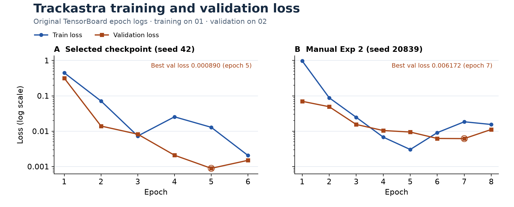

# Trackastra 微调、追踪策略与多尺度分割的综合结论

## 1. 结论概览

在 Fluo-N2DH-GOWT1 的本地 **02 验证序列**上，组员的 **Multi-scale Cell Recovery** 是本研究中效果最一致的改进。对同一套追踪权重和解码器，把单尺度 Cellpose-SAM v2 Mask 换为多尺度 Mask 后，四种追踪配置的 DET、TRA、CT 和 TF 都有所上升。以 TRA 和 OP_CTB 为主要指标时，**Multi-scale + 预训练 `general_2d` + ILP** 得分最高，TRA 为 **0.96198**，OP_CTB 为 **0.94060**，AOGM 为 **1098**。如果主要目标是获得完整轨迹，**Multi-scale + 预训练 `general_2d` + Greedy** 的 CT 和 TF 最高，分别为 **0.37288** 和 **0.95594**。八组预测 Mask 实验均匹配到 **0/4 次**真实分裂，细胞分裂仍是这套流水线的主要局限之一。

## 2. 实验口径

- **训练与验证。** Trackastra 从官方 `general_2d` 开始微调，训练使用有标注的 `01` 序列。模型选择、微调消融和集成评价均使用有标注的 `02` 序列。两条序列均为 92 帧。本文所有追踪指标都对应 **02 验证结果**，比较的结论限定在这个序列和已测试配置内。
- **GT Mask 对照。** 把同一套 `02_GT/TRA` 检测 Mask 交给两种权重和两种解码器，观察给定人工检测时，追踪器如何保留节点、连接细胞和处理分裂。使用 TRA、CT、AOGM 和 BC 评价。
- **端到端对照。** 输入为 `02` 原始图像和 Cellpose-SAM v2 的预测 Mask。分别用单尺度和组员的 Multi-scale 生成 Mask，再运行 `general_2d` 与微调权重、Greedy 与 ILP 的完整组合。GT 只用于评分。同一模型与解码器下成对比较两个 Mask 条件，可以直接测量更换分割输入对整条流水线的影响。

DET 衡量检测，SEG 衡量标注对象的分割重合程度，TRA 衡量追踪图的总体准确性。AOGM 是把预测图修正为参考图的代价，越低越好。CT 反映完整轨迹的匹配，TF 反映轨迹可被连续追踪的程度，BC(0) 是严格时间匹配下的分裂指标。OP_CTB 为 SEG 与 TRA 的平均值。联合读取这些指标，才能看到分数改善来自哪里。

## 3. 微调、参数搜索与复现性

*图 1 · 从两次训练的原始 TensorBoard 日志读取每个 epoch 的 `train_loss` 和 `val_loss`。纵轴使用对数刻度。左侧是后续追踪对照所用的 seed 42 运行，实际训练 6 轮，第 5 轮的验证损失最低（0.00089046）。右侧是手动 Exp 2，实际训练 8 轮，第 7 轮的验证损失最低（0.00617186）。*

八组 Grid Search 均使用 seed 42，从同一份 `general_2d` 权重独立启动，按最低验证损失保存 checkpoint。下表的分数基于 `02_GT/TRA` Mask 和 Greedy。

**表 1 · 八组微调参数搜索**

| 最大 epoch | 实际 epoch | 最佳 epoch | `train_samples` | 学习率 | 最佳验证损失 ↓ | CT ↑ | TRA ↑ | AOGM ↓ |
|---:|---:|---:|---:|---:|---:|---:|---:|---:|
| 2 | 2 | 2 | 16 | 1e-5 | 1.317067 | 0.897196 | 0.996624 | 97.5 |
| 2 | 2 | 2 | 16 | 5e-6 | 2.017452 | 0.867925 | 0.996537 | 100.0 |
| 2 | 2 | 2 | 89 | 1e-5 | 0.016232 | 0.897196 | 0.996624 | 97.5 |
| 2 | 2 | 2 | 89 | 5e-6 | 0.149374 | 0.897196 | 0.996624 | 97.5 |
| 10 | 5 | 4 | 16 | 1e-5 | 0.068140 | 0.897196 | 0.996624 | 97.5 |
| 10 | 5 | 4 | 16 | 5e-6 | 0.665823 | 0.867925 | 0.996537 | 100.0 |
| **10** | **6** | **5** | **89** | **1e-5** | **0.000890** | 0.897196 | 0.996624 | 97.5 |
| 10 | 5 | 4 | 89 | 5e-6 | 0.004663 | 0.897196 | 0.996624 | 97.5 |

六个并列模型的追踪图均为 **2509 个节点、2462 条边**，其中包含同一条错误边 `(6,43) → (7,45)`。轨迹 ID 一对一重映射后，92 帧 Mask 和轨迹表一致。后续选用 **10 epochs / 89 samples / 1e-5** 的 checkpoint，因为它在六组中的验证损失最低。六组的损失差异没有转化为不同的追踪图。

**表 2 · 固定超参数的三次独立训练**

| Seed | 实际 epoch | 最佳 epoch | 最佳验证损失 ↓ | CT ↑ | TRA ↑ | AOGM ↓ |
|---:|---:|---:|---:|---:|---:|---:|
| 43 | 2 | 1 | 0.013152 | 0.886792 | 0.996589 | 98.5 |
| 44 | 2 | 1 | 0.031201 | 0.897196 | 0.996624 | 97.5 |
| 20839 | 4 | 3 | 0.007421 | 0.897196 | 0.996624 | 97.5 |

CT 的均值 ± 样本标准差为 **0.893728 ± 0.006007**，TRA 为 **0.996612 ± 0.000020**，AOGM 为 **97.833 ± 0.577**。在固定验证序列和缓存条件下，TRA 波动较小，CT 能显示个别边变化对完整轨迹的影响。

**表 3 · 同一 seed 下的缓存复现**

| 运行条件 | Seed | 实际 epoch | 最佳 epoch | 最佳验证损失 | CT | TRA | AOGM |
|---|---:|---:|---:|---:|---:|---:|---:|
| 手动 Exp 2 | 20839 | 8 | 7 | 0.006172 | 0.886792 | 0.996589 | 98.5 |
| 自动运行，仓库根目录缓存 | 20839 | 4 | 3 | 0.007421 | 0.897196 | 0.996624 | 97.5 |
| 自动运行，沿用手动缓存 | 20839 | 8 | 7 | 0.006172 | 0.886792 | 0.996589 | 98.5 |

工作目录改变了相对路径 `.cache` 的解析位置。两份缓存的原始图像、GT Mask 和 GT 轨迹一致，但裁剪器 `WRRandomCrop._rng` 保存了不同状态。沿用手动缓存时，自动运行复现了原实验的训练轮数、评分和 `model.pt` 的 SHA256。复现实验需同时记录训练配置、seed、缓存状态与软件环境。这里的逐字节复现来自相同本地环境和缓存。

## 4. 给定人工检测时，微调和 ILP 各自改变了什么

**表 4 · 人工 GT/TRA Mask 对照**

| Trackastra 权重 | 解码器 | TRA ↑ | CT ↑ | AOGM ↓ | BC(0) ↑ | 节点 / 边 | 错误 / 缺失边 |
|---|---|---:|---:|---:|---:|---:|---:|
| 预训练 `general_2d` | Greedy | 0.996537 | 0.867925 | 100.0 | 0.0 | 2509 / 2461 | 1 / 1 |
| 预训练 `general_2d` | ILP | **0.999359** | **0.964912** | **18.5** | 0.4 | 2517 / 2463 | 2 / 0 |
| 微调 | Greedy | 0.996624 | 0.897196 | 97.5 | 0.4 | 2509 / 2462 | 1 / 0 |
| 微调 | ILP | 0.999290 | 0.910714 | 20.5 | 0.4 | 2517 / 2465 | 4 / 0 |

错误边和缺失边按相邻帧的 GT 边统计。固定 Greedy 时，微调把 CT 从 0.867925 提升至 0.897196，并补上了一个正确分裂的第二条子边。固定 ILP 时，原始权重的 CT 为 0.964912，高于微调权重的 0.910714。

两种权重下，ILP 都保留了 Greedy 输出中缺失的 **8 个检测节点**，将 AOGM 中的漏检节点数从 8 降为 0，这是 AOGM 下降的主要原因。ILP 同时增加了错误连接。表 5 列出四组间发生变化的边，每个节点表示为 `(帧, Mask 标签)`。四组共有的错误边 `(6,43) → (7,45)` 在此表之外。

**表 5 · GT Mask 对照中发生变化的边**

| 边 | 属于相邻帧 GT | 预训练 Greedy | 预训练 ILP | 微调 Greedy | 微调 ILP |
|---|---|---|---|---|---|
| `(1,40) → (2,41)` | 否 | — | — | — | 有 |
| `(5,42) → (6,43)` | 否 | — | 有 | — | 有 |
| `(19,49) → (20,50)` | 否 | — | — | — | 有 |
| `(82,22) → (83,24)` | 是 | — | 有 | 有 | 有 |

最后一行是分裂 `(82,22) → {(83,24),(83,25)}` 中的一条子边。原始权重的 ILP 补齐后，在严格匹配下识别到 **1/4 次**真实分裂。

**表 6 · 同一候选图上的解码器单次计时**

| Trackastra 权重 | 候选节点 / 边 | Greedy 求解时间 | ILP 求解时间 |
|---|---:|---:|---:|
| 预训练 | 2517 / 2465 | 0.0126 s | 1.261 s |
| 微调 | 2517 / 2468 | 0.0119 s | 1.035 s |

这组计时只包含解码步骤。分割、权重加载、模型推理、导出和评分有各自的耗时。

## 5. 接入组员的 Multi-scale 分割后，追踪效果如何

组员的 Multi-scale Cell Recovery 保留 `diameter=48` 的 Cellpose-SAM v2 原始实例，从 `diameter=32` 的预测中补入重叠比例不超过 0.10、通过最小面积 200 像素筛选的候选。我们接入该合并逻辑，逐帧检查原有实例像素保持一致。92 帧共从 **2621 增至 2658 个预测实例**，即在 29 帧额外加入 **37 个候选**。追踪组负责在同一批图像和成对 Mask 上比较微调权重与解码器，评价分割改动如何影响最终轨迹。

**表 7 · 八组端到端追踪结果**

| Cellpose Mask | 权重 | 解码器 | DET ↑ | TRA ↑ | CT ↑ | TF ↑ | AOGM ↓ | OP_CTB ↑ |
|---|---|---|---:|---:|---:|---:|---:|---:|
| 单尺度 | 预训练 | Greedy | 0.95614 | 0.95689 | 0.32759 | 0.93039 | 1245 | 0.93806 |
| 单尺度 | 预训练 | ILP | 0.95697 | 0.95751 | 0.30534 | 0.91417 | 1227 | 0.93837 |
| 单尺度 | 微调 | Greedy | 0.95610 | 0.95682 | 0.32203 | 0.92259 | 1247 | 0.93802 |
| 单尺度 | 微调 | ILP | 0.95697 | 0.95744 | 0.30075 | 0.91417 | 1229 | 0.93834 |
| Multi-scale | 预训练 | Greedy | 0.96003 | 0.96111 | **0.37288** | **0.95594** | 1123 | 0.94017 |
| Multi-scale | 预训练 | ILP | **0.96118** | **0.96198** | 0.34074 | 0.92583 | **1098** | **0.94060** |
| Multi-scale | 微调 | Greedy | 0.96039 | 0.96135 | 0.35000 | 0.93277 | 1116 | 0.94029 |
| Multi-scale | 微调 | ILP | **0.96118** | 0.96184 | 0.30657 | 0.92406 | 1102 | 0.94054 |

八组 SEG 均为 **0.91923**，BC(0) 和 BC(1) 均为 **0**。下表的差值由未舍入的分数计算。

**表 8 · 固定追踪配置时更换 Mask 的配对差值**

| 固定的追踪配置 | ΔDET | ΔTRA | ΔCT | ΔTF | ΔAOGM | ΔOP_CTB |
|---|---:|---:|---:|---:|---:|---:|
| 预训练 + Greedy | +0.00389 | +0.00422 | +0.04530 | +0.02555 | −122 | +0.00211 |
| 预训练 + ILP | +0.00421 | +0.00447 | +0.03540 | +0.01166 | −129 | +0.00223 |
| 微调 + Greedy | +0.00429 | +0.00454 | +0.02797 | +0.01018 | −131 | +0.00227 |
| 微调 + ILP | +0.00421 | +0.00440 | +0.00582 | +0.00990 | −127 | +0.00220 |

### 检测和连接的变化解释了收益

**表 9 · 预训练权重 + ILP 的图修正明细**

| 修正项 | 单尺度 | Multi-scale | 变化 |
|---|---:|---:|---:|
| 漏检节点 FN | 89 | 76 | −13 |
| 误检节点 FP | 193 | 217 | +24 |
| 待补连接 EA | 94 | 78 | −16 |
| 待删连接 ED | 0 | 1 | +1 |
| 需改类型的连接 EC | 3 | 3 | 0 |
| 需拆分的节点 NS | 0 | 0 | 0 |
| **加权总代价 AOGM** | **1227** | **1098** | **−129** |

在这个配对中，漏检和待补连接减少带来的收益超过了新增误检的代价。**37** 是分割阶段补入的候选数，**13** 是最终追踪图的漏检减少量。02 的 SEG 保持不变，改进主要体现在检测和追踪层面。

从单尺度 + 预训练 Greedy 出发，**先更换 Mask**，TRA 从 0.95689 升至 0.96111（**+0.00422**）；再在同一份 Multi-scale Mask 上**更换解码器**，TRA 升至 0.96198（**+0.00087**）。沿这条对照路径，总提升为 **0.00509**，较大的单步增益来自组员的分割改进。

### ILP 提高总体 TRA，Greedy 保留更完整的轨迹

对于同一份 Multi-scale Mask 和原始权重，Greedy 换成 ILP 后，输出节点从 2643 增至 2658，AOGM 从 1123 降到 1098，TRA 提高 0.00087。同时，CT 从 **0.37288 降至 0.34074**，TF 从 **0.95594 降至 0.92583**。微调权重下也观察到同样的排序变化。ILP 求解的是关联权重和图约束定义的目标，CTC 指标在导出之后另行评分。预测分裂数在原始权重下由 Greedy 的 1 次增至 ILP 的 4 次，在微调权重下由 2 次增至 7 次。严格匹配及允许 ±1 帧时，四种配置均匹配到 **0/4 次**真实分裂。

### 微调的收益依赖输入与指标

在 Multi-scale Mask 上，固定 Greedy 时，微调的 TRA 比预训练模型高 **0.00024**，CT 低 **0.02288**。固定 ILP 时，微调的 TRA 和 CT 分别低 **0.00014** 和 **0.03417**。在单尺度 Mask 下，两种解码器的微调版本也都低于对应预训练版本的 CT。人工 Mask 对照上观察到的微调优势，在真实分割流水线中只表现为部分指标的微小改善。

## 6. 推荐配置与结论边界

**课程项目主结果采用 Multi-scale + 预训练 `general_2d` + ILP。** 这套配置在本地 02 的 TRA、OP_CTB 最高，AOGM 最低。并列展示 **Multi-scale + 预训练 `general_2d` + Greedy** 的 CT 和 TF，可以清楚交代完整轨迹与总体分数的取舍。微调应作为消融保留，因为它说明了同一模型的效果如何随输入 Mask、解码器和评价指标而变化。

本项目最有力的证据是同一验证序列上的四组配对对照，显示组员的 Multi-scale 分割改动能在不同追踪配置下提高 DET、TRA 和 CT。对比同一原始权重 + ILP 的两种输入，人工检测条件的 TRA/CT 为 **0.99936 / 0.96491**，换成预测的 Multi-scale Mask 后为 **0.96198 / 0.34074**，严格分裂匹配由 1/4 降至 0/4。这个差距说明下游结果对输入检测和后续关联的交互高度敏感。分裂失败仍需结合母细胞与两个子细胞的逐帧 Mask 和连接来定位。

`02` 已用于 checkpoint 和配置选择，四组配对共享同一条 92 帧序列。结果支持**本地验证条件下**的配置比较与误差分析。要验证对其他视频的泛化，或判断微调与解码器之间较小的分差是否稳定，需要额外的有标注序列和重复实验。

## 附录 · 数据来源

正文中的训练过程图、指标表、配对差值和误差分析已汇总在本页。以下文件供核对原始记录。

- 微调参数搜索及图等价性。[微调报告](grid_search.md) · [网格原始评分](../results/grid_search.csv) · [CTC 图等价性](../results/ctc_equivalence.csv)
- 训练曲线、随机种子与训练缓存。[逐轮训练与验证损失](../results/training_losses.csv) · [复现性报告](reproducibility.md) · [种子原始评分](../results/seed_repeats.csv) · [缓存复现](../results/cache_reproduction.csv) · [缓存比对](../results/cache_comparison.json)
- GT Mask 追踪器对照。[Greedy/ILP 报告](greedy_vs_ilp.md) · [原始评分](../results/greedy_vs_ilp.csv) · [变化边](../results/changed_edges.csv) · [求解计时](../results/solver_benchmark.json)
- 组员的 Multi-scale 分割方法与集成运行。[分割报告](https://github.com/wyl2003/Cell-Tracking-Challenge/blob/72ed2c19d55ac606cf28f3d928e97e8362301248/plan/SEGMENTATION_IMPROVEMENT.md) · [运行配置](../results/multiscale_tracking_02/provenance.json) · [逐帧实例统计](../results/multiscale_tracking_02/segmentation_counts.csv)
- 端到端评分与 AOGM 明细。[八组对照评分](../results/multiscale_tracking_02/comparison.csv) · [CTC 评分与图修正明细](../results/multiscale_tracking_02/ctc_metrics.csv)
